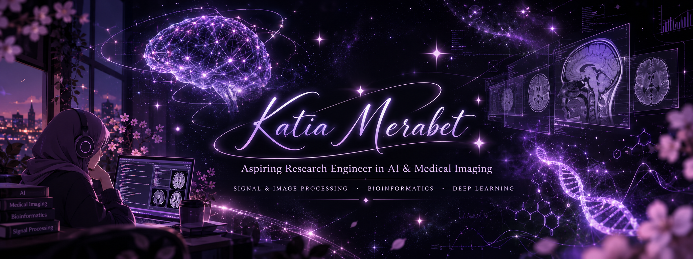

# ✦ Katia Merabet ✦

### Aspiring Research Engineer in AI & Medical Imaging

**🔭 Open to M2 Internship Opportunities**

---

### ✨ About Me

I'm **Katia**, a Master's student in **Signal & Image Processing**, with a previous Master's degree in **Bioinformatics**.

I'm particularly interested in **medical imaging**, **deep learning**, and the ways artificial intelligence can help us understand complex biological and visual data.

I enjoy learning across disciplines and exploring research questions at the intersection of **AI, imaging, and life sciences**.

> ✦ *Driven by curiosity, inspired by discovery.*

### 🛠️ Languages & Tools

**Programming & data**

  
  

**AI, computer vision & development tools**

  
  
  

### 🧠 Research Interests

`Medical Imaging` · `Bioinformatics` · `Deep Learning`

### 📊 Top Languages

Automatically generated from public GitHub repositories; not a measure of overall proficiency.

---

*✦ Curious minds connect ideas across disciplines. ✦*

[LinkedIn](https://www.linkedin.com/in/katia-merabet-0345721b2) · [Email](mailto:katia.merabet@etu.univ-littoral.fr)

